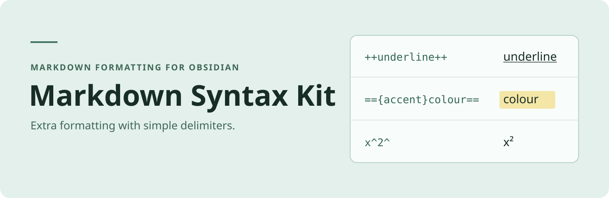

# Markdown Syntax Kit _(markdown-syntax-kit)_



Add underlines, spoilers, superscripts, subscripts, coloured highlights, custom spans and fenced divs in Obsidian.

## Install

Requires Obsidian 1.7.4 or later. Once listed, search for **Markdown Syntax Kit** under **Settings → Community plugins → Browse**.

For manual installation, use a [GitHub release](https://github.com/soizo/markdown-syntax-kit/releases) with the `markdown-syntax-kit` manifest ID. Older releases use the original ID. To build from source, run these commands in the repository:

```sh
npm install
npm run build
```

Copy `manifest.json`, `main.js` and `styles.css` to `.obsidian/plugins/markdown-syntax-kit` in your vault, then enable the plugin under **Community plugins**. [BRAT](https://github.com/TfTHacker/obsidian42-brat) can install it once a release with the new ID is available.

If you are switching from Extended Markdown Syntax, disable the old plugin, copy its `data.json` into the new plugin folder and reassign any custom hotkeys.

## Usage

| Format | Markdown |
| --- | --- |
| Underline | `++underlined text++` |
| Spoiler | `\|\|hidden text\|\|` |
| Superscript | `x^2^` |
| Subscript | `H~2~O` |
| Coloured highlight | `=={accent}highlighted text==` |
| Custom span | `!!{my-class}styled text!!` |

A fenced div starts with `:::` and ends at a blank line, a change of block context or the end of the note.

```markdown
::: my-class
Apply a CSS class to this block.
```

Select text and type a delimiter to wrap it. Typing the delimiter on an entirely wrapped selection removes the pair. At an empty cursor, typing `++` inserts both delimiters. Use the **More format** editor menu or the command palette to apply formatting. Plugin settings let you enable individual formats, customise highlight colours and save CSS classes for reuse.

See the [syntax rules](docs/rule.md) for delimiter details and [reading-mode escaping limits](docs/rule.md#7-note-delimiter-escaping). Spoiler delimiters in table cells cannot be escaped in Source mode.

## Credits

Maintained by [soizo](https://github.com/soizo). Based on [Extended Markdown Syntax](https://github.com/kotaindah55/extended-markdown-syntax) by Kotaindah55 (Sheva Ihza).

Thanks to [Pandoc](https://pandoc.org/MANUAL.html), [CommonMark](https://spec.commonmark.org/), [GitHub Flavoured Markdown](https://github.github.com/gfm/), [Discord](https://discord.com/), [Superschnizel](https://github.com/Superschnizel/obisdian-fast-text-color), [Exaroth](https://github.com/Exaroth/mdx_custom_span_class), [Mara-Li](https://github.com/Mara-Li/obsidian-regex-mark), [marcel-goldammer](https://github.com/marcel-goldammer/obsidian-keyword-highlighter) and [mattcoleanderson](https://github.com/mattcoleanderson/obsidian-dynamic-text-concealer).

## Contributing

Use [GitHub Issues](https://github.com/soizo/markdown-syntax-kit/issues) for questions, bug reports and proposed changes. Run `npm test` when changing the code.

## Licence

[MIT](LICENSE). Copyright © 2025 Kotaindah55 (Sheva ihza).
